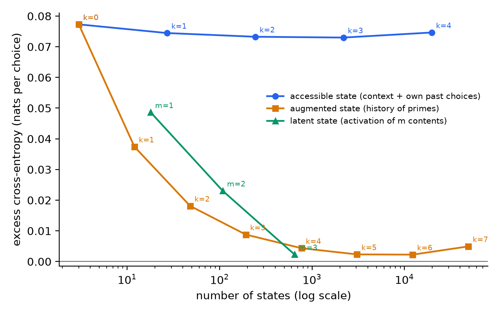

# The price of memorylessness

A small simulation accompanying the paper *The Price of Memorylessness:
Markov, Memory and Decision-Making* (Youssef El Ani).

The paper argues that no description of a human decision-maker's past can
be at once **sufficient** (it predicts the next choice as well as the full
history), **substantive** (bounded, so that it does not simply restate the
history) and **accessible** (made of information available to the agent).
Every Markovian model must give one of the three up. This simulation puts a
number on what each choice costs.

## The agent

At each trial the agent chooses one of `K = 3` options.

| Variable | Meaning | Accessible to the agent? |
|---|---|---|
| `o_t` | which option is on promotion today | yes |
| `p_t` | masked prime for one option (probability 0.4 per trial) | **no** |
| `a_t` | activation of each content: `a_t = 0.7 · a_{t-1} + prime at t-1` | **no** |
| `c_t` | the agent's choice | yes (afterwards) |

Choice probabilities: `softmax(1.0 · [promotion] + 1.0 · a_t)`. A prime acts
only from the next trial on, so the past always precedes its effect.

## Three families of Markovian predictors

Each family defines a state and estimates `P(choice | state)` from
10 million simulated trials (10,000 agents × 1,000 trials). It is evaluated
on 2 million fresh trials by its **excess cross-entropy** over the true
choice probabilities (nats per choice; 0 = as good as the true model).

- **F1, accessible**: today's promotion plus the last `k` promotions and the
  agent's own last `k` choices. This is everything the agent has access to.
- **F2, augmented**: today's promotion plus the last `k` prime events. This is
  the full history, truncated at depth `k`.
- **F3, latent**: today's promotion plus the activation of `m` of the 3
  contents, discretised into 6 levels. This is a bounded variable posited by
  the modeller.

## Results

The present state alone loses 0.077 nats per choice against the true model.
That gap is everything memory explains. Columns: number of states, excess
cross-entropy, and the share of the gap recovered.

| Model | States | Excess | Recovered |
|---|---:|---:|---:|
| F1 accessible, k = 1 | 27 | 0.0745 | 4% |
| F1 accessible, k = 3 | 2,187 | 0.0730 | 6% |
| F1 accessible, k = 4 | 19,683 | 0.0746 | 3% |
| F2 augmented, k = 1 | 12 | 0.0374 | 52% |
| F2 augmented, k = 3 | 192 | 0.0088 | 89% |
| F2 augmented, k = 5 | 3,072 | 0.0023 | 97% |
| F2 augmented, k = 7 | 49,152 | 0.0049 | 94% |
| F3 latent, m = 1 | 18 | 0.0486 | 37% |
| F3 latent, m = 2 | 108 | 0.0231 | 70% |
| F3 latent, m = 3 | 648 | 0.0023 | 97% |

What the numbers show:

1. **Accessible states are never sufficient.** Adding the agent's own past
   choices and contexts recovers at most 6% of the effect of memory. With
   more history the estimate gets worse, because the state space grows
   faster than the data (k = 4).
2. **Sufficiency through the history costs states.** The augmented state
   recovers 97% of the effect only with thousands of states. With finite data
   it then degrades again (k = 7), because a longer history is also a model
   that needs more evidence to fit.
3. **A latent state is cheap only if it is complete.** Tracking the activation
   of every content recovers 97% of the effect with 648 states. Tracking one
   or two contents recovers 37% and 70%. The modeller must know in advance
   which contents can be primed, and the agent has no access to the variable
   that does the work.



## What this does and does not show

This is an illustration, not evidence about people. The agent is built so
that masked primes matter, and the parameters (prime rate, decay, weights)
are arbitrary. What the simulation does show is that the three costs in the
paper are real and measurable even in a toy world: a model that stays
accessible remains inadequate, and a model that becomes adequate pays in
either state-space size or in a variable the agent cannot access.

## Running it

```bash
pip install -r requirements.txt
python simulate.py
```

It runs in about 20 seconds and writes `results/results.csv`,
`results/summary.json` and `figures/price_of_memorylessness.{png,pdf}`.
